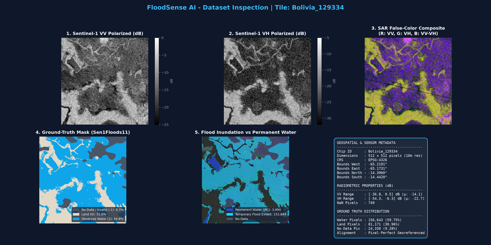

# FloodSense AI 🌊
### Satellite-Based Flood Inundation Mapping Using Sentinel-1 SAR and Deep Learning

FloodSense AI is a deep learning project that uses **Sentinel-1 Synthetic Aperture Radar (SAR) imagery and a U-Net segmentation model** to identify potential flood-inundated areas. It combines pixel-level flood segmentation, geospatial analysis, area estimation, and an interactive web dashboard to make satellite-based flood analysis easier to explore.

The project focuses on **mapping observed surface-water inundation**, rather than forecasting future floods.

## ✨ Features

- **SAR-based flood segmentation:** Processes VV and VH polarization channels from Sentinel-1 imagery.
- **U-Net deep learning model:** Performs pixel-level binary segmentation of flood-inundated areas.
- **Permanent-water filtering:** Uses reference water masks to distinguish dynamic inundation from permanent water in training labels.
- **Geospatial analysis:** Preserves raster georeferencing and estimates the area represented by predicted flood pixels.
- **Interactive dashboard:** Visualizes flood predictions and geospatial information through a web interface.
- **REST API:** Provides endpoints for model information, sample inference, image uploads, and evaluation reports.
- **Evaluation and visualization:** Includes validation metrics, held-out geographic evaluation, dataset audits, and prediction inspection figures.

## 🖥️ Dashboard and Visualizations

FloodSense AI includes visualizations for inspecting satellite imagery, reference masks, and model predictions.

### Dataset Inspection

The inspection figures compare Sentinel-1 VV and VH imagery, a false-color SAR composite, reference water labels, and permanent-water information.



> If this image does not appear on GitHub, check that `reports/figures/sample_Bolivia_129334.png` is committed to the repository and that the filename and capitalization match.

Additional inspection figures are available in [`reports/figures/`](reports/figures/).

## 🧠 How It Works

The project follows this workflow:

1. **Data preparation:** Load Sentinel-1 VV/VH raster chips and corresponding reference masks.
2. **Preprocessing:** Normalize the SAR channels using statistics calculated from valid training pixels.
3. **Label preparation:** Exclude invalid labels and distinguish dynamic inundation from permanent water.
4. **Model inference:** Pass the two-channel SAR input through a U-Net segmentation model.
5. **Mask generation:** Convert output logits into flood probabilities and binary predictions using a selected threshold.
6. **Geospatial analysis:** Preserve raster spatial metadata and estimate inundated area from predicted pixels.
7. **Visualization:** Display results through inspection plots, API responses, and the web dashboard.

### Model Architecture

The baseline model is a U-Net convolutional neural network implemented in PyTorch.

| Property | Configuration |
|---|---|
| Architecture | U-Net |
| Input channels | 2: VV and VH |
| Output channels | 1 segmentation logit |
| Parameters | Approximately 7.76 million |
| Loss function | 0.5 masked binary cross-entropy + 0.5 Dice loss |
| Optimizer | AdamW |
| Learning rate | 0.0005 |
| Weight decay | 0.0001 |
| Training duration | 10 epochs for the reported baseline |

Invalid pixels are excluded from the relevant training loss and evaluation calculations.

## 🛰️ Dataset

The project uses the hand-labelled subset of **Sen1Floods11**, a dataset for flood detection using Sentinel-1 imagery.

The local dataset audit reported the following split sizes:

| Split | Number of chips |
|---|---:|
| Training | 252 |
| Validation | 89 |
| Test | 90 |
| Bolivia held-out evaluation | 15 |
| Total | 446 |

Each chip is a 512 × 512 raster. The SAR inputs contain VV and VH backscatter channels.

### Label Processing

The target mask is constructed to focus on dynamic inundation:

`(LabelHand == 1) & (JRCWaterHand == 0)`

Here, `LabelHand` identifies labelled surface water, while `JRCWaterHand` identifies permanent water. Invalid labels and invalid SAR pixels are excluded as appropriate.

The Bolivia subset is used for a held-out geographic evaluation to investigate transfer to an unseen event. Its results should be interpreted as a limited geographic generalization test, not evidence of universal performance.

**Dataset note:** The raster dataset is not included in this repository. Obtain it from its official source and follow the dataset's applicable terms of use.

## 📊 Model Evaluation

The following results were reported by the project's evaluation scripts for the current baseline checkpoint.

### Validation Results

| Metric | Score |
|---|---:|
| Intersection over Union (IoU) | 0.4208 |
| F1-score | 0.5923 |
| Precision | 0.5185 |
| Recall | 0.6907 |
| Accuracy | 0.9240 |
| Loss | 0.5373 |

### Held-Out Bolivia Evaluation

| Metric | Score |
|---|---:|
| Intersection over Union (IoU) | 0.3526 |
| F1-score | 0.5214 |
| Precision | 0.7417 |
| Recall | 0.4020 |
| Accuracy | 0.8897 |
| Loss | 0.5160 |

These results show that performance differs between validation and the held-out geographic evaluation. In particular, the lower recall on the Bolivia subset indicates that the model misses a substantial proportion of reference flood pixels at the evaluated threshold.

Accuracy should be interpreted cautiously because the number of non-flood pixels can be much larger than the number of flood pixels. IoU, F1-score, precision, and recall provide additional insight into segmentation performance.

Results are specific to the current dataset, checkpoint, preprocessing, and evaluation setup. They are not a guarantee of performance in other regions or flood events.

Detailed reports are available in [`reports/`](reports/).

## 🛠️ Technology Stack

### Machine Learning and Geospatial Processing
- Python
- PyTorch
- NumPy
- Rasterio and geospatial raster processing tools

### Backend
- FastAPI
- Uvicorn
- Pytest

### Frontend
- Next.js
- React
- TypeScript
- Tailwind CSS
- Leaflet / React Leaflet

### Development Tools
- Git and GitHub
- Jupyter Notebooks
- NVIDIA GPU for model training and inference

## 🏗️ Project Structure

```text
FloodSenseAI/
├── backend/
│   ├── app/
│   │   └── main.py
│   └── tests/
├── configs/
│   └── config.yaml
├── data/
│   ├── raw/
│   ├── masks/
│   ├── processed/
│   └── splits/
├── experiments/
├── frontend/
├── models/
│   ├── dataset.py
│   ├── unet.py
│   ├── losses.py
│   ├── metrics.py
│   ├── train.py
│   ├── evaluate.py
│   └── predict.py
├── notebooks/
├── reports/
│   └── figures/
├── scripts/
├── requirements.txt
├── pytest.ini
├── .gitignore
└── README.md
```

The local dataset, generated outputs, and model checkpoints may be excluded from Git through `.gitignore`. Consequently, the repository source code alone may not be sufficient to run inference until the required data and checkpoint are supplied.

## 🚀 Getting Started

### Prerequisites

- Python 3.10 or a compatible version supported by the project dependencies
- Node.js and npm
- Git
- The dataset files required by the training or inference pipeline
- A trained model checkpoint for inference

A CUDA-compatible NVIDIA GPU is recommended for accelerated training, but CPU execution may be possible with reduced performance.

### 1. Clone the Repository

```bash
git clone https://github.com/Ritvik-io/FloodSenseAI.git
cd FloodSenseAI
```

### 2. Set Up the Python Environment

On Windows PowerShell:

```powershell
python -m venv .venv
.\.venv\Scripts\Activate.ps1
python -m pip install --upgrade pip
pip install -r requirements.txt
```

If PowerShell blocks environment activation, consult the Python virtual-environment documentation for your system's execution policy.

### 3. Prepare the Dataset

Obtain the required Sen1Floods11 files from the official dataset source and arrange them according to the paths expected by the project configuration and data-loading code.

Verify that the expected raster inputs, reference masks, and data split files are present before running training or evaluation.

The full dataset is not distributed through this repository.

### 4. Train or Evaluate the Model

Inspect the configuration and available command-line arguments before running the scripts.

Typical entry points are:

```bash
python models/train.py
python models/evaluate.py
```

These commands assume that the scripts' expected configuration, dataset paths, and dependencies are correctly set up. Check each script for supported arguments and required files.

### 5. Start the Backend

From the repository root, run:

```bash
uvicorn backend.app.main:app --reload
```

If the application module or import path differs in your local version, use the import path specified in the backend source.

Once the server starts, open:

- API base URL: `http://127.0.0.1:8000`
- Interactive API documentation: `http://127.0.0.1:8000/docs`

The API requires the appropriate dependencies and any required model artifacts for inference endpoints to work.

### 6. Start the Frontend

Open a separate terminal:

```powershell
cd frontend
npm install
npm run dev
```

Open `http://localhost:3000` in your browser.

Configure the frontend's backend URL and any required map-tile provider settings according to the frontend implementation. Some map providers require an API key or a correctly configured tile URL.

## 🔌 API Endpoints

The current backend implementation includes the following endpoints:

| Method | Endpoint | Purpose |
|---|---|---|
| GET | `/health` | Health check |
| GET | `/model/info` | Model information |
| GET | `/model/active` | Active model status |
| POST | `/predict/sample/{chip_id}` | Run inference on a configured sample chip |
| POST | `/predict/upload` | Submit an image for prediction |
| GET | `/metrics/reports` | Retrieve available evaluation reports |

Refer to the automatically generated API documentation at `/docs` for request formats, parameters, and response schemas.

## 🧪 Testing

Run the backend and project tests from the repository root:

```bash
pytest
```

The project previously reported 13 passing tests. Test results can vary with code changes, environment configuration, and available data or model artifacts.

## ⚠️ Limitations and Responsible Use

- This is a research and portfolio project, not an operational flood-warning system.
- Performance can vary across geographic regions, flood events, land-cover types, and acquisition conditions.
- SAR imagery can be affected by noise, terrain, vegetation, and other sources of ambiguity.
- The model's output depends on preprocessing, the selected probability threshold, reference labels, and checkpoint version.
- Area estimates depend on correct georeferencing and appropriate pixel-area calculations.
- A visually plausible segmentation is not proof that a predicted flood boundary is accurate.
- Predictions should be checked against reference data and independent observations before being used for decisions.

Do not use this project as the sole basis for emergency response, evacuation, or other safety-critical decisions.

## 🔮 Future Improvements

- Evaluate additional geographic regions and unseen flood events.
- Improve recall while controlling false-positive predictions.
- Compare U-Net against alternative segmentation architectures.
- Add confidence and uncertainty visualization.
- Strengthen geospatial validation and area-estimation checks.
- Improve map-layer selection and imagery alignment.
- Add reproducible training configurations and model-version tracking.
- Investigate integration with additional satellite products and reference datasets.

## 📄 License

This project is licensed under the MIT License. See [`LICENSE`](LICENSE).

The license applies to the project code covered by it; datasets, map tiles, pretrained assets, and third-party dependencies remain subject to their respective terms and licenses.

## 👨‍💻 Author

**Ritvik Sharma**

Computer Science and Engineering student interested in deep learning, computer vision, geospatial AI, and applied research.

GitHub: [@Ritvik-io](https://github.com/Ritvik-io)

---

*FloodSense AI — Exploring satellite-based flood inundation mapping through deep learning and geospatial visualization.*
